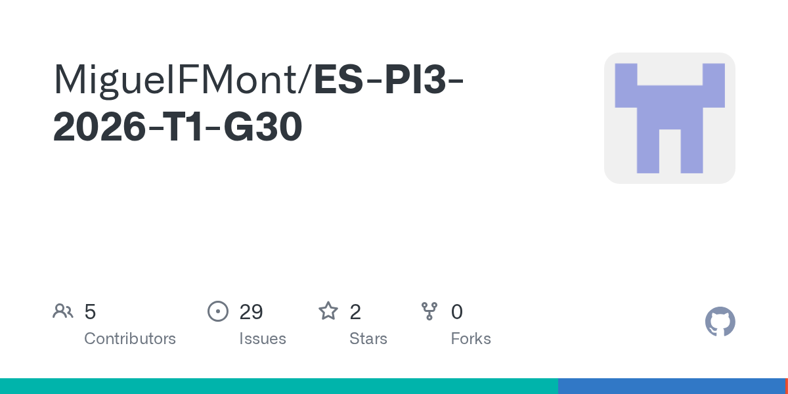

## 👋 >_ Hi, I'm Gabriel!

Thanks for stopping by.

I'm **Gabriel Martins**, a Software Engineering student at PUC-Campinas in Brazil. I focus on backend development and data, and I'm exploring cybersecurity.

I'm currently working on **ConsultaFácil**, a web application that helps clinics manage doctors' schedules and book appointments.

## >_ About Me

- **Education** · Software Engineering at PUC-Campinas, Brazil
- **Backend projects** · Java 21, JavaScript, TypeScript, Node.js, and REST APIs
- **Databases** · SQL, PostgreSQL, and MongoDB
- **Coursework** · Python fundamentals
- **Currently exploring** · Data engineering and cybersecurity

## 🚀 >_ Software Projects

<table>
  <tr>
    <td align="center" width="33%">
      
       
      <a href="https://github.com/gabrielsuj/PI_IV-TIME-22"><strong>ConsultaFácil</strong></a>
       
      Medical appointment scheduling
    </td>
    <td align="center" width="33%">
      
       
      <a href="https://github.com/gabrielsuj/ES-PI2-2025-T3-G02"><strong>NotaDez</strong></a>
       
      Class rosters and grade management
    </td>
    <td align="center" width="33%">
      
       
      <a href="https://github.com/MiguelFMont/ES-PI3-2026-T1-G30"><strong>MesclaInvest</strong></a>
       
      Simulated trading of startup tokens
    </td>
  </tr>
</table>

My contributions

- **ConsultaFácil calendar.** I built the React calendar views and added API support for fetching appointments by doctor and date range. [Calendar pull request](https://github.com/gabrielsuj/PI_IV-TIME-22/pull/80)
- **ConsultaFácil schedule conflicts.** I worked on the API checks and confirmation flow that show staff which appointments a schedule change would affect before they apply it. [Schedule changes pull request](https://github.com/gabrielsuj/PI_IV-TIME-22/pull/81)
- **NotaDez.** I implemented route authentication and contributed to student CSV import and PostgreSQL-backed API endpoints.
- **MesclaInvest.** I contributed to the Firestore data model and startup catalog API, connected the Flutter dashboard to the API, and fixed how trades were aggregated in the chart.

<!-- Add a "## ✍️ >_ Technical Writing" section once your first article has a public link. -->

## >_ Get in Touch

I'm open to connecting about software engineering opportunities and collaborations.
